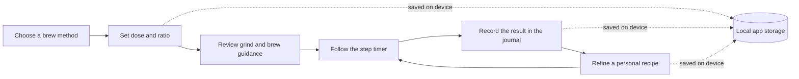
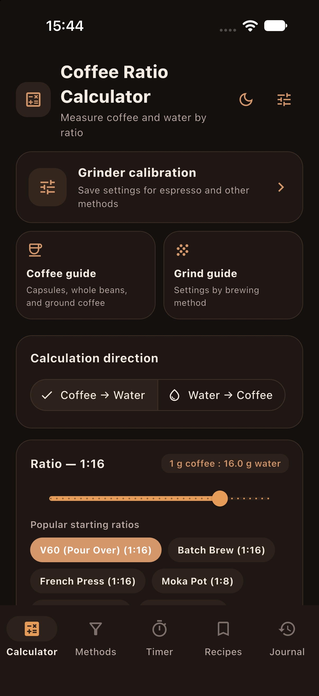

<p align="center">
  
</p>

<h1 align="center">Brew App</h1>

<p align="center"><strong>A practical companion for brewing better coffee at home.</strong></p>

<p align="center">
  <a href="https://flutter.dev"></a>
  <a href="https://dart.dev"></a>
  <a href="LICENSE"></a>
  
</p>

---

## About

Brew App is an open-source Flutter application for planning, timing, and recording coffee brews. It brings dose calculations, method guides, grinder notes, custom recipes, a step-by-step timer, and a brew journal together in one place.

The app works offline. Recipes, journal entries, preferences, and grinder calibration notes are stored on the device. There are no user accounts or cloud-sync services in this project.

> Brew parameters are starting points, not guaranteed outcomes or equipment-independent rules. Adjust them to your coffee, water, grinder, brewer, and taste.

## Features

| Feature | What it does |
| --- | --- |
| **Coffee calculator** | Calculate coffee or water from a brew ratio, and explore common starting profiles. |
| **16 brewing methods** | Browse recipes, grind guidance, temperatures, timed steps, and practical tips. |
| **Coffee guide** | Find selection, use, and storage tips for whole-bean, pre-ground, and capsule coffee. |
| **Grind guide** | Compare method-specific starting grind recommendations and adjust based on flow and taste. |
| **Grinder calibration** | Save settings by grinder and brew method. Use the animated dial or enter a value directly. |
| **Custom recipes** | Create, edit, and remove personal brew recipes. |
| **Brew timer** | Follow method or recipe steps with a countdown and active-step highlighting. |
| **Brew journal** | Record brews, ratings, parameters, and tasting notes; review recent activity and summaries. |
| **Backup and restore** | Export and import recipes, journal entries, and grinder settings as JSON. |
| **Themes and motion** | Use light, dark, or system appearance, with support for reduced-motion preferences. |

### Brewing methods

Espresso · V60 · Chemex · AeroPress · French Press · Moka Pot · Turkish Coffee · Kalita Wave · Clever Dripper · Siphon · Vietnamese Phin · Batch Brew · Hario Switch · Origami Dripper · Cold Drip · Cold Brew

### How the app fits together



## Screenshots

<p align="center">
  
</p>

<p align="center"><em>Coffee ratio calculator in the English interface.</em></p>

## Language and platforms

- **Platforms:** iOS and Android.
- **Framework:** Flutter; the repository also includes web and macOS project scaffolding.
- **Interface language:** English on every supported device locale. Number separators may follow the device region.

## Getting started

### Requirements

- Flutter SDK compatible with the Dart SDK constraint in [`pubspec.yaml`](pubspec.yaml).
- Xcode and an iOS Simulator for iOS development on macOS.
- Android Studio or Android SDK tooling for Android development.

### Run locally

```bash
git clone <YOUR_REPOSITORY_URL>
cd <YOUR_REPOSITORY_DIRECTORY>
flutter pub get
flutter run
```

To run on a specific device, list available devices and pass its ID:

```bash
flutter devices
flutter run -d <DEVICE_ID>
```

### Run checks

```bash
flutter analyze
flutter test
```

### Run from VS Code

1. Install the Flutter and Dart extensions.
2. Start an iOS Simulator or connect an Android device/emulator.
3. Open **Run and Debug**, choose **Brew App (iOS Simulator)**, and press **F5**; or run `flutter run` in the integrated terminal.

The **Run Brew App web preview** task starts a local web preview at `http://127.0.0.1:8123`. A web build is a preview of the Flutter app, not an iOS Simulator window embedded in VS Code.

## Data and privacy

- Brew data is stored locally using `shared_preferences`.
- The app does not provide accounts, analytics, or cloud synchronization.
- Android app-data backup is disabled. iOS device backups follow system settings and may include app data.
- A backup is copied as JSON text. It leaves the device only if you paste or save it elsewhere; exported notes may contain personal information.
- Deleting app data or uninstalling the app may remove locally stored records. Keep a backup if you need to preserve them.
- Grinder calibration is a personal reference only. The app does not connect to or control physical grinder hardware.

## Project structure

```text
lib/
├── data/       Built-in brewing method data
├── models/     Brew methods, recipes, journal entries, and calibration
├── screens/    Calculator, guides, methods, timer, recipes, and journal
├── state/      App state and local persistence
├── theme/      Light and dark themes
├── utils/      Number, ratio, date, and duration formatting
└── widgets/    Shared UI components and animations
test/           Model, state, and widget tests
```

## Technology

- [Flutter](https://flutter.dev/) and Dart
- [Provider](https://pub.dev/packages/provider) for state management
- [shared_preferences](https://pub.dev/packages/shared_preferences) for on-device persistence
- [intl](https://pub.dev/packages/intl) for locale-aware formatting

## Contributing

Contributions are welcome. Before opening a pull request:

1. Keep changes focused and include tests for behavior changes.
2. Run `dart format` on changed Dart files.
3. Run `flutter analyze` and `flutter test`.
4. Describe the change and any manual device checks in the pull request.

For security-sensitive reports, use GitHub's private vulnerability reporting or Security Advisories when enabled for the repository. Do not post credentials, private keys, or personal backup data in an issue.

## Release checklist

This repository is source code, not a ready-to-publish store submission. Before distributing a production release:

- Set the store listing, signing credentials, bundle/application identifiers, icons, and support contact for the publisher.
- Configure a production Android keystore in the ignored `android/key.properties` file before building release APKs or app bundles. Release builds fail if signing is not configured.
- Review the in-app privacy notice and terms. They are draft copy and still contain publisher/contact placeholders.
- Publish a privacy policy at a stable public URL and make store disclosures match the app's actual data behavior.
- Verify age ratings, target regions, and all applicable legal requirements.
- Build and test release artifacts on the intended devices.

## License

Brew App is available under the [MIT License](LICENSE).
